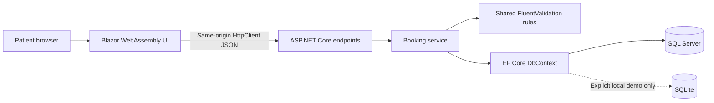
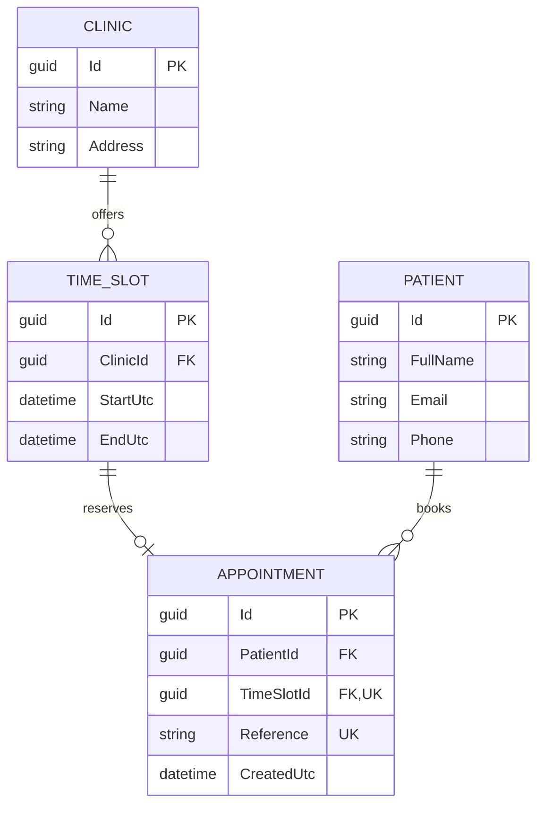
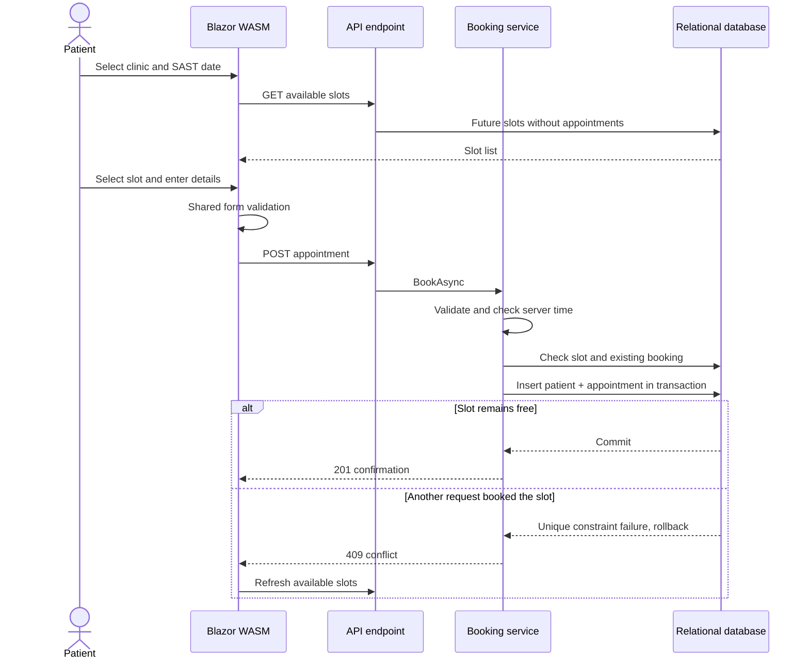

# System design

## Architecture

A small layered modular application, hosted in one process with a client-side WebAssembly UI. Contracts are shared; EF entities remain server-side.

The API also serves client static assets. No CORS configuration is necessary for this same-origin arrangement. The UI is standalone WASM, not Blazor Server or server-interactive rendering.

## Entity relationship diagram

Additional unique index: `(ClinicId, StartUtc)`. Check constraint: `EndUtc > StartUtc`. Foreign keys use restricted deletion so dependent records cannot disappear accidentally. The model permits a patient with several appointments; the anonymous first-version booking flow creates a new patient row per booking to avoid treating an unverified email as identity.

## Booking sequence

## Integrity and error handling

The initial availability and duplicate checks improve feedback but are not concurrency controls. The unique appointment-slot database index enforces the invariant. SQL Server duplicate-key numbers 2601/2627 and SQLite's unique-constraint code 2067 are handled; the service verifies that the slot was actually booked before returning a conflict. Unrelated persistence failures propagate to centralized ProblemDetails handling.

The race test deterministically commits a competing booking between the service's availability check and insert. It checks the actual unique constraint, conflict response from the service, and rollback of the losing patient insert. This validates the interleaving on SQLite; it is not a SQL Server load test.

The API uses explicit DTO mapping. No patient records can be retrieved through public endpoints. Confirmation deliberately contains scheduling information without echoing contact details. Random reference values are not authentication tokens. Request bodies and patient fields are not logged; structured logs use appointment/slot IDs.

## SOLID and implementation decisions

- **Single responsibility:** endpoints translate HTTP, the service enforces booking rules, the context persists data, and client components manage interaction.
- **Dependency inversion:** endpoints depend on IBookingService; the service receives DbContext, IValidator, TimeProvider and ILogger through DI.
- **Interface segregation:** one small booking interface; no broad service or generic repository contract.
- **Open/closed and substitution:** rules live in a validator and time is injectable. Additional workflows should be added as focused services without weakening existing booking invariants.
- **Pragmatism:** four projects rather than microservices or separate domain/infrastructure projects for this limited scope. EF Core already provides unit-of-work behavior.
- **Migration lifecycle:** SQL Server migrations are generated without a database connection. Application startup never migrates SQL Server automatically. Only the explicit local-demo flag creates/refreshes its disposable SQLite database.

## Assessment technology mapping

| Area | Implemented | Deferred/alternative |
|---|---|---|
| Frontend | Blazor WASM, MudBlazor, HttpClient, shared FluentValidation | Fluent UI alternative unnecessary |
| Backend | ASP.NET Core API, EF Core, FluentValidation, Serilog | Explicit mapping replaces AutoMapper |
| Database | SQL Server model/migration; opt-in SQLite demo | PostgreSQL alternative unnecessary; no Dapper need |
| Testing | xUnit, real SQLite constraints, in-process API tests | Moq unnecessary; browser automation can be added |
| Authentication | Demo limitation documented | Identity/JWT and role/ownership rules pending scope confirmation |
| Operations | Local tool manifest, OpenAPI, liveness endpoint | CI/CD and Docker deferred |
| Optional | None | SMS/email, calendars, SignalR, GraphQL |
