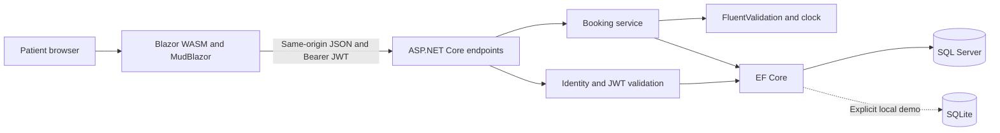
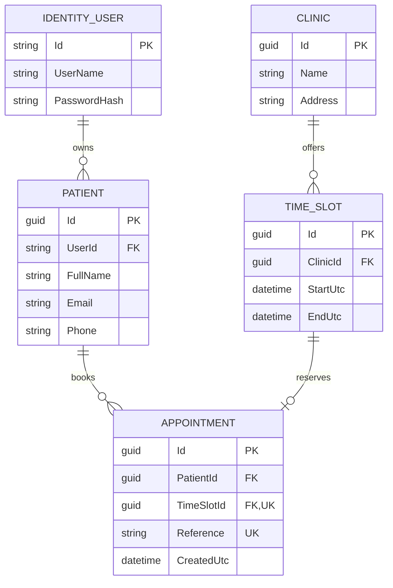
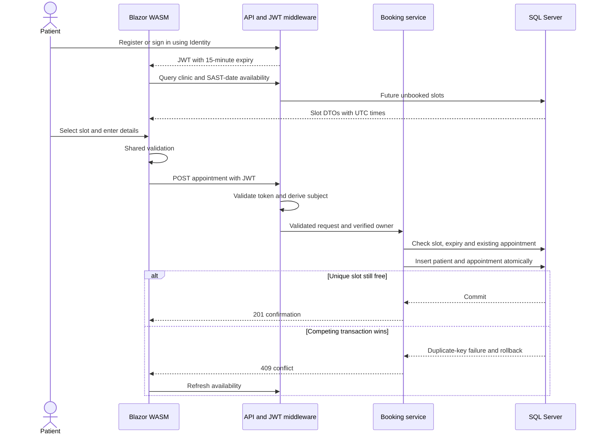

# System design

## Architecture

A small layered modular application. The API hosts the standalone Blazor WASM assets; HttpClient uses the same origin. EF entities remain server-side and DTOs/validation rules are shared.

The host uses .NET 10 MapStaticAssets endpoint aliases for the stable Blazor bootstrap URL; published output does not depend on an unresolved HTML fingerprint placeholder or the legacy framework-file branch.

## Data model

Patient.UserId is nullable to preserve pre-identity records; new API bookings always use the verified JWT subject. Identity's additional standard tables are omitted from this domain-focused ERD. Unique `(ClinicId, StartUtc)` prevents duplicate schedule starts; the end-after-start check and restricted foreign keys enforce basic consistency. Patient details are captured per booking, not deduplicated by unverified email.

## Booking sequence

## Concurrency and errors

Availability and AnyAsync prechecks are feedback, not locking. The unique index on Appointments.TimeSlotId is authoritative. EF SaveChanges wraps both inserts in a transaction. SQL Server 2601/2627 and SQLite unique code 2067 are recognized; after clearing tracked entries, the service verifies that a competing appointment exists before returning a conflict. Other database failures propagate to centralized ProblemDetails handling.

The SQL Server test gates two real HTTP requests after both have passed the precheck. Exactly one commits and one returns 409, with one patient/appointment and no remaining availability. It separately executes duplicate-key rollback and foreign-key enforcement on SQL Server. A deterministic SQLite interleaving test and unexpected-FK failure test preserve lower-level regression coverage. This is correctness verification, not a throughput/load benchmark.

## Security

Identity owns password policy/hashing and account lockout. JWT validation checks issuer, audience, signature and lifetime. Signing material comes from external configuration; Development/Testing may use a newly generated ephemeral key. The client retains tokens only in memory. Authentication precedes authorization, which is required on booking and confirmation endpoints. Confirmation retrieval filters by both reference and owner. No browser patient identifier is trusted.

The only adopted capability is patient booking; no unnecessary roles are seeded. Registration has generic failure messages; login failures are generic and account endpoints have bounded rate limits. Email verification/recovery, MFA, refresh tokens and immediate revocation are explicitly outside this assessment. Production requires TLS, durable secrets and an operational security design.

## Design choices and lifecycle

Endpoints handle HTTP; IBookingService handles business decisions; DbContext persists; components manage interaction. DI supplies validator, clock and logger. Explicit mappings are small and reviewable; no AutoMapper or generic repository is needed. Tests use real relational constraints rather than meaningless mocks, so Moq is not added.

SQL Server migrations are explicit deployment actions, never automatic normal-startup changes. The design-time factory can generate migrations without a connection. Only --demo-local in Development creates/seeds an isolated SQLite file. Browser tests use a fresh file under ignored work/. Normal SQL Server seed is an explicit command that exits after execution.

Inline validation has reserved vertical space so correcting errors cannot move the submit button during a pointer press. A browser regression reproduces the original issue and verifies one submission, confirmation focus and refreshed availability.

## Evidence

Rendered diagrams and browser screenshots are in docs/evidence. Validation.md records actual commands, results and limitations. AssessmentCompliance.md attributes mandatory, recommended, illustrative and optional items to the original PDF.
